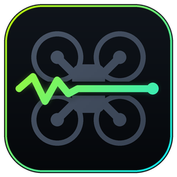
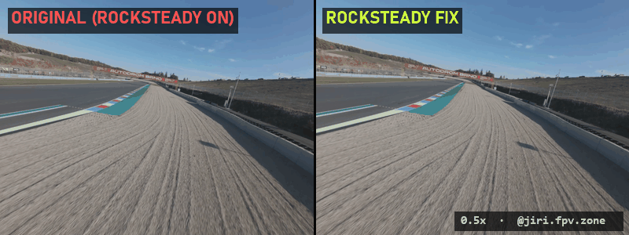
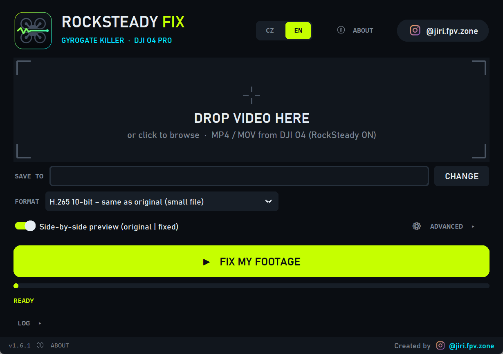

<p align="center">
  
</p>

<h1 align="center">RockSteady Fix</h1>
<p align="center"><b>Removes "gyrogate" snaps from DJI O4 Pro footage already shot with RockSteady ON</b><br>
Free · open source · runs 100 % locally · Windows<br>
made by <a href="https://www.instagram.com/jiri.fpv.zone/"><b>@jiri.fpv.zone</b></a></p>

<p align="center">
  <a href="../../releases"><b>⬇ Download for Windows</b></a> ·
  <a href="#cz--česky">🇨🇿 Česky</a>
</p>

<p align="center"></p>

---

## The problem

Newer **DJI O4 Pro** air units can ship with a different gyro (ICM‑40609‑D, marked "I469D") in place of the earlier MP66.
On some units the stabilisation then goes wrong, known in the FPV community as **"gyrogate"**: the image jumps in a single
frame, often again and again. With RockSteady ON this is baked straight into the recording.

The repair tools I know of (FPVFlow, o4fix, DJIFix) work on the gyro data in the file. That data is only recorded with
**RockSteady OFF**. If you already shot with RockSteady ON, they have nothing to work with.

**RockSteady Fix is for exactly that footage.** It measures the motion from the image itself and removes the snaps.
If you can still re‑shoot, record with RockSteady OFF and use those tools instead: more information in the file means
a better starting point.

## How it works

1. **Dense optical flow** of every frame pair, sampled on a grid across the whole image.
2. **Finding the snaps.** Parallax from flying low changes smoothly over time, while a snap moves the image all at once.
   Each grid point is compared with its own short temporal median, which leaves the snaps and not the parallax. The
   result is fitted as a 3D camera rotation, so pure roll snaps count too.
3. **Rolling‑shutter split snaps.** A snap can land mid‑readout, so part of the rows jump one frame earlier. These are
   found row by row, and a row only counts if most of its columns moved together (local motion doesn't do that).
4. **Fixing only what is broken.** Around the snaps, only the fast part of the camera rotation is removed, optionally
   with a row‑wise correction. Each section gets the best of 6 variants, chosen by the predicted remaining judder.
5. **Cropping only where needed.** Crop zoom eases in just for the fixed sections and is 1.0 everywhere else.
6. **Hands off the rest.** Frames outside the fixed sections get no warp and no crop. Long runs of jumps (impacts,
   landings) are treated as real motion and left alone.

## Results on my test clip

3:24 of low flying over a race track (4K 4:3, 50 fps, Linear), measured on the final H.265 file. A **jump** is how far the
motion of one frame differs from its neighbours, taken from the median dense optical flow in horizontal bands, in px at
960 px image width. The band at the bottom of the frame is left out because the blurred ground right under the drone
can't be measured reliably.

| | Original | Fixed |
|---|---|---|
| Frames with a jump over 4 px, whole clip | 169 | **16** (6 of them the landing, left alone on purpose) |
| Frames with a jump over 2 px, whole clip | 475 | **96** |
| 99th percentile of the jump, whole clip | 5.26 px | **1.93 px** |
| Largest jump at 0:33–0:37 | 14.0 px | **2.1 px** |
| Largest jump at 0:50–0:56 | 19.8 px | **2.5 px** |
| Largest jump at 2:33–2:36 | 11.3 px | **2.3 px** |
| Largest jump at 2:50–2:56 | 13.0 px | **3.1 px** |

Maximum crop in this clip was 9.95 %, and 6233 of 10187 frames had no crop at all. It is a big improvement, not a perfect
fix: small leftovers remain, and it can miss a snap (see [Limitations](#limitations)).

## Quick start

<p align="center"></p>

1. Download `RockSteadyFix_vX.Y.Z.zip` from [Releases](../../releases), unzip it and run `RockSteadyFix.exe`. No installation.
2. Drag your clip into the window, or drop it on the `.exe` icon.
3. Hit **FIX MY FOOTAGE**. The result lands in `_stabilized` next to your clip.

> **Windows SmartScreen:** the app is not code‑signed, so Windows may say *"Windows protected your PC"*.
> Click **More info → Run anyway**. The full source code is in this repository, and you can build the `.exe` yourself.

## Output

| Format | File | Notes |
|---|---|---|
| **H.265 10‑bit** (default) | `<name>_fix.mp4` | Same codec and bit rate as the source, so about the same file size |
| **ProRes 422 HQ** | `<name>_fix.mov` | About 13× bigger, for when you want maximum headroom for grading |

You also get an optional side‑by‑side preview `<name>_compare.mp4` and `<name>_fix_report.json` with the detected snaps
and the method used for each section. **Your original is never modified.**

The whole file is re‑encoded either way. On frames outside the fixed sections I measured 52–57 dB PSNR against the
original in H.265.

## Speed

On my PC (32 threads, RTX 4090), H.265 output:

| Clip | Time |
|---|---|
| 18 s of 4K | about 1 minute |
| 3:24 of 4K | about 9.5 minutes |

H.265 is encoded on the graphics card when one is available, trying NVIDIA, then AMD, then Intel. Without one it falls
back to the CPU, which is **much** slower (about 2 fps here, so over an hour and a half for 4 minutes of footage). In
that case, choosing ProRes is much faster, at the cost of file size.

## Limitations

- **Tested on very little so far:** three full clips and short sections of two more, all from one drone and one day of flying, DJI O4 Pro, 4K 4:3, 50 fps, Linear FOV, on Windows 11.
  Other modes (Wide FOV, 16:9, 60/100 fps) and other cameras are **untested**. The lens model assumes the O4 Pro's
  Linear FOV.
- **Encoders:** the NVIDIA and CPU paths are tested. AMD and Intel are untested. If they fail to open, the app moves on
  to the next one.
- **It can miss a snap.** Bursts close to real, hard movement are the hardest case. Lower the thresholds in Advanced and
  try again.
- **It only fixes snaps:** not jello, prop wash or a damaged unit.
- **Video only:** audio tracks and DJI's data tracks are not copied to the output.
- **Windows only** (64‑bit).

Doesn't work on your clip? Please open an [issue](../../issues) with a link to a short original clip (5–20 s, untouched
file from the SD card), your settings and the report `.json`. The report contains the full paths of your files, so remove
them if you prefer. Clips where it fails are the most useful ones.

## Settings (Advanced)

| Setting | Default | Meaning |
|---|---|---|
| Snap threshold – shift | 3 px @960 | smaller = more sensitive |
| Snap threshold – roll | 0.15° | smaller = more sensitive |
| Smoothing strength in zone | 0.16 s | path smoothing inside a fixed section (×1.6 is tried as well) |
| Zone margin before/after snap | 0.6 s | how far a fixed section extends |
| Correction fade in/out | 0.3 s | soft start and end of the correction |
| Crop ramp in/out | 0.8 s | how slowly the crop eases in and out |
| Maximum crop | 10 % | sections needing more get a weaker correction; skipped if under 50 % would fit |

## Other tools

- **Footage with RockSteady OFF:** [FPVFlow](https://github.com/rodrigosclosa/fpvflow), o4fix
  ([vadimbryl](https://github.com/vadimbryl/o4fix), [ThaumielSparrow](https://github.com/ThaumielSparrow/o4fix))
  and [DJIFix](https://github.com/parhipov/DJIFix) repair the gyro data for Gyroflow.
- **Gyroflow's Optical correction** ([docs](https://docs.gyroflow.xyz/app/getting-started/supported-cameras/dji)) measures
  motion from the image and can ignore the gyro data in the file. It stabilises the whole clip rather than only the
  snaps. I have not compared the two.

## Command line

```bat
RockSteadyFix.exe <video> <output folder>
```

Runs without the window using default settings and writes `RockSteadyFix_log.txt` to the output folder.

## Build from source

With 64‑bit Python 3.13 on Windows:

```bat
build.bat
```

This creates `dist\RockSteadyFix.exe`. To run it without building: `pip install -r requirements.txt`, then `python app.py`.

## Credits & license

- Built on [PyAV](https://github.com/PyAV-Org/PyAV) / [FFmpeg](https://ffmpeg.org/), [OpenCV](https://opencv.org/),
  [NumPy](https://numpy.org/), [CustomTkinter](https://github.com/TomSchimansky/CustomTkinter) and
  [tkinterdnd2](https://github.com/Eliav2/tkinterdnd2). See [THIRD_PARTY_NOTICES.md](THIRD_PARTY_NOTICES.md).
- Thanks to the community research on gyrogate: [Oscar Liang](https://oscarliang.com/dji-o4-pro-gyro-stabilization-issue/),
  o4fix ([vadimbryl](https://github.com/vadimbryl/o4fix), [ThaumielSparrow](https://github.com/ThaumielSparrow/o4fix)),
  [FPVFlow](https://github.com/rodrigosclosa/fpvflow) and [DJIFix](https://github.com/parhipov/DJIFix).
- License: **GPL‑3.0** (see [LICENSE](LICENSE)). Provided without any warranty. Keep your originals.
- Not affiliated with or endorsed by DJI. "DJI", "O4" and "RockSteady" are trademarks of their owners.

**Like it? Follow for more FPV → [@jiri.fpv.zone](https://www.instagram.com/jiri.fpv.zone/)** and tag me in your fixed footage.

---

## CZ – česky

**RockSteady Fix** odstraní cuknutí stabilizace („gyrogate“) z videí **DJI O4 Pro už natočených se zapnutým RockSteady**.
Nástroje jako FPVFlow, o4fix nebo DJIFix opravují gyrodata, která se ukládají jen s RockSteady OFF, takže na tyhle záběry nestačí.

1. Stáhni ZIP z [Releases](../../releases), rozbal ho a spusť `RockSteadyFix.exe` (nic se neinstaluje).
2. Přetáhni video do okna nebo na ikonu `.exe`.
3. Klikni na **SPUSTIT OPRAVU**. Výsledek najdeš ve složce `_stabilized` vedle videa, ve výchozím nastavení jako H.265 10 bit
   ve stejném datovém toku jako originál. Volitelně jako ProRes 422 HQ (asi 13× větší).

Vše běží lokálně a originál se nemění. Opraví se jen zasažené úseky a ořez je jen tam, kde je potřeba. Jazyk přepneš vpravo
nahoře (CZ / EN). Pokud Windows zobrazí „Systém Windows ochránil počítač“, klikni na **Další informace → Přesto spustit**.

Zatím je to otestované jen na DJI O4 Pro ve 4K 4:3, 50 fps, Linear. Nefunguje to na tvém klipu? Založ [issue](../../issues)
s odkazem na krátký originální klip.

Autor: **[@jiri.fpv.zone](https://www.instagram.com/jiri.fpv.zone/)**
